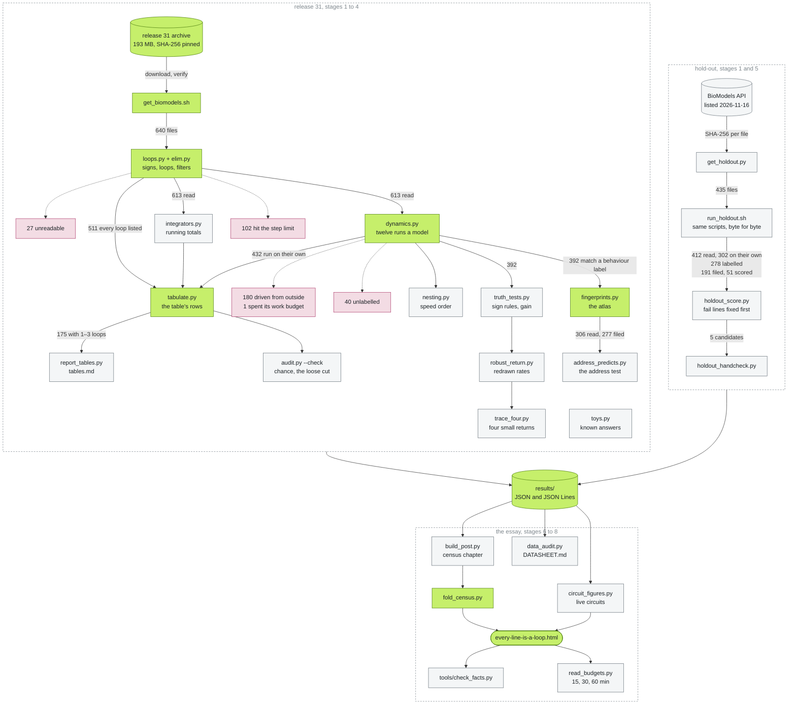

# Every line is a loop

*What would a maximally plausible periodic table for biology look like?*

Feedback loops come in whole numbers, so the circuits in cells can be tabled like chemistry's elements:
[the essay](https://kat-titter.github.io/every-line-is-a-loop/every-line-is-a-loop.html) proposes the table, and
this code tests it on BioModels.

## 01 what this is

A loop is there or it isn't, and it feeds itself or it brakes, so a circuit's loops can be counted. Count the loops,
the brakes among them and the loops through a running total, and the table holds 4, 9 and 16 elements for one, two
and three loops. The code reads every loop from each published model's equations, runs the model to see what it
does, and checks the table's claims against that behaviour. It reads two sets: the 640 curated models of BioModels
release 31, and a hold-out of 435 models curated since, scored against fail lines fixed before the hold-out was read.

- The two sign rules hold without exception: no clock without a brake, no memory without a self-feeding loop
  (392 labelled models in release 31, 278 in the hold-out).
- The address test fails: a model's square in the table predicts how it answers a push no better than the sign rules
  alone (p = 0.64 on 89 release 31 models, p = 0.84 on 51 hold-out models). The essay reports it as found.

The essay is `every-line-is-a-loop.html`, one self-contained page with no external requests.
`count-the-elements.html` redirects to its census chapter.

## 02 reproduce

One command runs everything from the raw downloads to every number and figure in the essay:

```sh
python3.9 -m venv .venv && .venv/bin/pip install -r requirements.txt
caffeinate -i sh analysis/run_all.sh 8
```

`8` is the number of parallel jobs. `caffeinate -i` keeps a Mac awake; drop it on other systems. `analysis/run_all.sh`
runs eight stages: 1 data, 2 the release 31 census, 3 tables, toys and the speed-order test, 4 the tests of the laws
and the atlas, 5 the hold-out census and its score, 6 the essay's generated blocks, 7 the fact check, 8 the data audit
(`results/DATASHEET.md`) and the three read budgets. Downloads land in `data/` and the census chapter's intermediate
build in `build/`; both are gitignored.

The committed results came from an Apple M5 (10 cores, 16 GB), macOS 26.6.2 and Python 3.9.6. A full run takes
about 3 hours with 4 workers on that machine: the two loop passes 63 min (under load), behaviour through the atlas
63 min, the hold-out census 44 min, the page and its checks 3 min (measured 2026-11-19 and 20).

**What reproduces and what can move.** Every random draw is seeded, every per-model limit counts work rather than
seconds, BLAS runs one thread per job, and parallel jobs write in model order, so a slower or busier machine files the
same records. The wall-clock timeouts of earlier runs are now work budgets (`analysis/budget.py`). Loop searches stop
at 5,000,000 steps or 20,000 loops; simulations stop at a budget of solver work, counted in CVODE's derivative
evaluations, and a model that spends it is recorded as `budget: solver work ...`:

- `analysis/dynamics.py`: 3e10 per model.
- `analysis/fingerprints.py`: 4.1e10 per model.
- `analysis/truth_tests.py`: 1.1e11 per model and test.
- `analysis/robust_return.py`: 1.1e11 per model.
- `analysis/loops.py`, `analysis/integrators.py`, `analysis/elim.py`: counts only (search steps, loops, arcs, CVODE's
  steps per output interval).

Each model also runs in its own process under a 6-hour wall-clock safety net that only stops a runaway and says so on
stderr; no measured run comes near it. `analysis/README.md` (Choices that shape the numbers) says how each budget was
measured.

To check a rebuild, `git status results/` lists the files that changed; the JSON Lines records also differ in their
timing field `seconds`, and any other difference is a moved result. Then `.venv/bin/python tools/check_facts.py`
checks every fact on the page against `results/` (stage 7 runs it too).

To publish, `sh tools/publish.sh "message"` exports the tree minus `HANDOFF.md` and `x-pack/` as one commit on the
public repository's main branch. It first fetches public main and fast-forwards to it when a pull request was merged
on GitHub, stops if the two have diverged, and never forces.

## 03 data

- **Release 31.** BioModels release 31, 26 June 2017: one archive from the EBI FTP
  (`BioModels_Database-r31_pub-sbml_files.tar.bz2`, 193 MB). `analysis/get_biomodels.sh` pins its SHA-256,
  `b6fba03e9441157196cf566b493b64f3e2d08a07294786c672c9518a4c110532`, checks it on download and extracts the 640
  curated SBML files to `data/r31_curated/`.
- **Hold-out.** 435 models curated since release 31. On 2026-11-16 BioModels listed 1,096 manually curated models,
  456 of them not in release 31, 21 of those not SBML. `analysis/get_holdout.py` fetched the 435 one at a time through
  the BioModels API. The list is `results/holdout_ids.json`, and `results/holdout_manifest.json` holds a SHA-256 per
  file; a fresh download rewrites each file's hash there, so a file BioModels has changed since shows up in
  `git status results/`. "Curated since" is not "published since": 83 were submitted before release 31.
- **Licence.** The models are BioModels' and stay under BioModels' terms. The files do not all say CC0: of the 640
  release 31 files, 352 carry a CC0 dedication in their notes, 71 the older notice "copyright (c) The BioModels Team"
  and 220 neither; in the hold-out, 126 of 435 carry CC0. No model was edited.
- **Datasheet.** [`results/DATASHEET.md`](results/DATASHEET.md) holds the rest: the pipeline step by step, every
  exclusion as the code names it, class balance, duplicates and families, how independent the hold-out is, the
  headline numbers recounted by group, the choices that shape the numbers and the known biases.
  `analysis/data_audit.py` writes it.

## 04 pipeline

Each script is a node; the counts on the edges are models, from `results/DATASHEET.md`. Release 31 and the hold-out
run the same scripts and meet in `results/`, which every figure and number on the page is built from.



Every script in `analysis/`, in the order `run_all.sh` runs it. Files under `results/` are named without the folder.

| stage | script | reads | writes |
|---|---|---|---|
| 1 | `analysis/get_biomodels.sh` | the EBI FTP | `data/r31.tar.bz2`, `data/r31_curated/` |
| 1 | `analysis/get_holdout.py` | the BioModels API, `data/r31_curated/`, `holdout_ids.json` | `data/holdout_curated/`, `holdout_manifest.json` (`holdout_ids.json` with `--relist`) |
| 2 | `analysis/loops.py` | `data/r31_curated/` | `r31_structure_traj.jsonl`, `r31_structure_random.jsonl` |
| 2 | `analysis/elim.py` | imported by `loops.py` | nothing (run alone: one JSON line per model) |
| 2 | `analysis/dynamics.py` | `list_ok.txt` (the 613 read, written by `run_all.sh`) | `r31_dynamics.jsonl` |
| 2 | `analysis/integrators.py` | `list_ok.txt` | `r31_integrators.jsonl` |
| 3 | `analysis/tabulate.py` | `r31_structure_*.jsonl`, `r31_dynamics.jsonl`, `r31_integrators.jsonl` | `tables_traj.json`, `tables_random.json` |
| 3 | `analysis/report_tables.py` | `tables_traj.json`, `tables_random.json` | `tables.md` |
| 3 | `analysis/toys.py` | nothing: builds three toy models as SBML | `toys.json` |
| 3 | `analysis/nesting.py` | `r31_structure_traj.jsonl`, `r31_dynamics.jsonl`, `data/r31_curated/` | `nesting.json` |
| 4 | `analysis/truth_tests.py` | `r31_structure_traj.jsonl`, `r31_dynamics.jsonl`, `data/r31_curated/` | `truth_tests.json` |
| 4 | `analysis/audit.py` | `r31_structure_traj.jsonl`, `r31_dynamics.jsonl`, `r31_integrators.jsonl`, `tables_traj.json`; with `--check`, the essay | `audit.json` |
| 4 | `analysis/robust_return.py` | `truth_tests.json`, `data/r31_curated/` | `robust_return.json` |
| 4 | `analysis/fingerprints.py` | `r31_dynamics.jsonl`, `r31_structure_traj.jsonl`, `data/r31_curated/` | `fingerprints.json` |
| 4 | `analysis/address_predicts.py` | `fingerprints.json`, `r31_dynamics.jsonl`, `r31_structure_traj.jsonl` | `address_predicts.json` |
| 4 | `analysis/trace_four.py` | `robust_return.json`, `data/r31_curated/` | `trace_four.json` |
| 5 | `analysis/run_holdout.sh` | `data/holdout_curated/`, a copy of `analysis/` in `data/holdout_run/` | `holdout_structure_traj.jsonl`, `holdout_dynamics.jsonl`, `holdout_integrators.jsonl`, `holdout_tables_traj.json`, `holdout_truth_tests.json`, `holdout_robust_return.json`, `holdout_fingerprints.json`, `holdout_address_predicts.json` |
| 5 | `analysis/holdout_score.py` | the `holdout_*` files above, `holdout_ids.json`, `holdout_manifest.json`, `tables_traj.json` | `holdout_score.json` |
| 5 | `analysis/holdout_handcheck.py` | `holdout_score.json`, `holdout_dynamics.jsonl`, `data/holdout_curated/` | `holdout_handcheck.json` |
| 6 | `analysis/build_post.py` | `tables_traj.json`, `tables_random.json`, `toys.json`, `r31_structure_traj.jsonl`, `r31_dynamics.jsonl`, `r31_integrators.jsonl`, `truth_tests.json`, `holdout_score.json` | `build/count-the-elements.html` |
| 6 | `analysis/circuit_figures.py` | the essay's `gen:` markers, `tables_traj.json`, `fingerprints.json`, `r31_structure_traj.jsonl` | `every-line-is-a-loop.html`, between its markers |
| 6 | `analysis/fold_census.py` | `build/count-the-elements.html`, the essay, `truth_tests.json`, `robust_return.json`, `nesting.json`, `r31_structure_traj.jsonl`, `r31_dynamics.jsonl` | `every-line-is-a-loop.html`, between its markers |
| 6 | `analysis/bio_figures.py`, `analysis/elements.py`, `analysis/interactive.py`, `analysis/loop_morph.py`, `analysis/post_math.py`, `analysis/story_figures.py`, `analysis/table_figures.py` | imported by `build_post.py`, `circuit_figures.py` and `fold_census.py` | nothing: they return figures, element names and MathML as strings |
| 7 | `tools/check_facts.py` | the essay, `results/`, the model code in `circuit_figures.py` | `fact_trace.md` |
| 8 | `analysis/data_audit.py` | `data/`, `results/`, git history | `data_audit.json`, `DATASHEET.md` |
| 8 | `analysis/read_budgets.py` | the essay | nothing: prints the three read budgets against 15, 30 and 60 min |
| all | `analysis/run_all.sh` | | runs stages 1 to 8 |

`analysis/README.md` describes each script and the choices that shape the numbers.

## 05 layout

```
every-line-is-a-loop.html   the essay: one self-contained page
count-the-elements.html     redirect to the essay's census chapter
analysis/                   the pipeline (04) and its README
results/                    every output the essay reads, DATASHEET.md and tables.md
tests/                      test_known_answers.py, test_budget.py, test_reproduce.py (06)
tools/
  check_facts.py            every data fact on the page against results/
  check.py                  page structure, tags and screenshots
  check_refs.py             reference markers against the reference list
  svg_overlaps.py           text collisions in every figure
  bake.py                   Figure 1's first frame, written in so it reads without JavaScript
  clip_close_line.py        Figure 1 captured frame by frame
  pixdiff.py                pixel diff of two screenshots
  export_pdf.py             the essay as a PDF, through its print stylesheet
  pdfpages.js               PDF pages to PNG on macOS
  export_xpack.py           x-pack/ stills re-exported from the page
  publish.sh                the public repository's one-commit export
  publish_gate.sh           stops a publish that would undo a change made on public main
  publish_reviewed.txt      hand-merged public commits someone has read, for the gate
x-pack/                     share assets: figure stills, a short video, a thread (private, left out by publish.sh)
HANDOFF.md                  state and decisions for whoever picks the project up (private, left out by publish.sh)
README.md                   this page
CITATION.cff                how to cite the essay and the code
LICENSE                     MIT, for the code
LICENSE-TEXT.md             CC BY 4.0, for the essays' text and figures
requirements.txt            the pinned environment the results came from
requirements-dev.txt        adds ruff for work on the code
pyproject.toml              ruff settings only; the analysis runs as plain scripts
.gitignore                  keeps data/, build/, .venv/ and PDFs out
```

## 06 tests

```sh
.venv/bin/python -m unittest tests/test_known_answers.py -v   # about 12 s
.venv/bin/python -m unittest tests/test_budget.py -v          # a spent budget files the same record every run
.venv/bin/python -m unittest tests/test_reproduce.py -v       # a few minutes
.venv/bin/python tools/check_facts.py                          # before every publish
```

- `tests/test_known_answers.py` runs five circuits with answers known from theory or from the papers that built
  them through the census's own functions: a toggle (one self-feeding loop, two resting states), the repressilator
  (one loop, three brakes, ticks), a braking ring set 5% either side of its secant floor (ticks above, settles below),
  Khammash's antithetic controller (a paired running total) and Tyson's adapter (no loop, returns exactly).
- `tests/test_reproduce.py` reruns stages on small inputs and compares them field for field with `results/`: the
  census on six release 31 models, the tables from the committed census records, the toy models, the essay's model
  asserts and the page's facts.
- `tools/check_facts.py` checks every data fact on the essay against the results file and key that produce it,
  writes the trace to `results/fact_trace.md` and exits 1 if a fact is missing.

The cases that read BioModels skip until `analysis/get_biomodels.sh` has filled `data/r31_curated/`.

## 07 cite

Cite the essay and the code from [`CITATION.cff`](CITATION.cff); GitHub's "Cite this repository" reads it. It also
lists BioModels and Baudier, Fages and Soliman (2018), whose filters the census follows.

## 08 licence

The code is MIT ([`LICENSE`](LICENSE)). The essays' text and figures are CC BY 4.0
([`LICENSE-TEXT.md`](LICENSE-TEXT.md)). The models stay under BioModels' terms (03).
